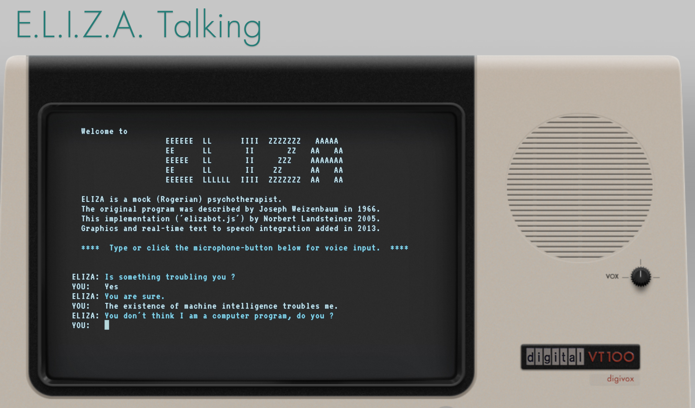

Words

## Think: Week 1 (January 11 - 17)

Welcome! This course sits where two conversations meet. The first is about **digital humanities** (DH): a field that has spent decades bringing computers to the study of literature, history, art, and culture, by digitizing archives, counting words across thousands of novels, mapping historical data, and building tools and websites. The second is about **generative AI**: chatbots, image generators, and coding assistants that have, in just a few years, become part of how many people read, write, and work.

This module's readings set up both conversations. Matthew Kirschenbaum's "What Is Digital Humanities and What's It Doing in English Departments?" is one of the most widely assigned introductions to the field: notice how often he describes DH as a *community* and a set of *practices*, rather than a single method. The *99% Invisible* episode "The ELIZA Effect" tells the story of ELIZA, a chatbot built at MIT in the 1960s, and of how quickly people began to treat a very simple program as if it understood them. That tendency, now called the "ELIZA effect," is worth keeping in mind all semester.

**To do this week:**

- Read Kirschenbaum's [essay](https://mkirschenbaum.wordpress.com/wp-content/uploads/2011/03/ade-final.pdf) and listen to (or read the [transcript](https://99percentinvisible.org/episode/the-eliza-effect/transcript) of) [the podcast](https://99percentinvisible.org/episode/the-eliza-effect/).
- Watch the lecture video in Webcourses and look through the [Module One slides](slides/moduleone.html).
- Complete the **Activity Verification** survey in Webcourses by **Friday, January 15**.
- Create a free account with at least one AI assistant (see below), so you're ready for next week.

## Do: Week 2 (January 18 - 24)

### Watch First

Joseph Weizenbaum, the creator of ELIZA, in 1978 footage from Boston's public television station.

<iframe src="https://www.youtube.com/embed/UCcdiFa7fhM" title="Artificial Intelligence in 1978" style="position: absolute; top: 0; left: 0; width: 100%; height: 100%; border: 0;" allow="accelerometer; clipboard-write; encrypted-media; gyroscope; picture-in-picture" allowfullscreen></iframe>

[Artificial Intelligence in 1978](https://www.youtube.com/watch?v=UCcdiFa7fhM): Joseph Weizenbaum, archival footage (GBH Archives), about 4 minutes.

**As you watch:** Listen for how Weizenbaum describes what ELIZA is actually doing. Then watch for the moments in your own conversations this week when you start treating a program as if it understands you.

### Exercise: Talking to Chatbots, Then and Now

The most common way people use generative AI is the chat window: you type, and it types back. But chatbots are much older than ChatGPT. In this exercise, you'll have three conversations that span sixty years of chatbot history, and pay close attention to how each one makes you feel like someone is listening. **Take a screenshot during each conversation**: you'll need one from each for your post.

#### Before You Start: Set Up Your Accounts

If you haven't already, create a free account with at least one of [ChatGPT](https://chatgpt.com/), [Claude](https://claude.ai/), or [Google Gemini](https://gemini.google.com/). You can also sign in to [Microsoft Copilot with your UCF account](https://cdl.ucf.edu/faculty-multimedia-center-ai-tools/). You don't need a paid subscription for this course. Take a minute to look around the interface: find where your past chats are saved, how to start a new chat, and whether you can choose between different models.

#### Conversation One: ELIZA (at least 10 minutes)

Talk with [E.L.I.Z.A. Talking](https://www.masswerk.at/eliza/), Norbert Landsteiner's re-creation of Joseph Weizenbaum's original 1966 program (the one from the podcast). ELIZA plays a therapist who mostly turns your statements back into questions. Try talking to it about your week, about starting this class, or about whether computers can think. Then try to "break" it: what happens when you ask it a factual question, change the subject abruptly, or repeat yourself? **Screenshot 1:** your favorite moment.

#### Conversation Two: A Modern Chatbot (at least 10 minutes)

Open ChatGPT, Claude, Gemini, or Copilot and start a new chat. Ask it to play ELIZA's role by pasting in this prompt:

> For this conversation, please reply as a person-centered therapist, like the 1960s ELIZA chatbot. Keep your responses short and focus on reflecting my statements back to me as questions.

Have a similar conversation to the one you had with ELIZA. Then step out of the role-play and ask it directly: "How are you different from ELIZA?" **Screenshot 2:** a moment that surprised you.

#### Conversation Three: An AI-Built ELIZA (a few minutes)

Try [Future ELIZA](https://anastasiasalter.net/HumanitiesAI/demos/WeekOne/), a chatbot that was itself *made* by an AI: the course designer prompted Claude to build an ELIZA-style bot that responds "like an AI from the future." There's no AI running behind this page, only the pre-written responses Claude generated. **Screenshot 3:** any exchange with Future ELIZA.

As you move between the three, keep notes on:

- How often each one repeats itself, and which words or phrases it relies on
- Moments when it felt like it understood you, and moments when the illusion broke
- What you think each one is actually doing when it responds

### Discussion

Start your post with a short introduction: your name, your major or area of interest, and any experience you've had with generative AI so far. (Your introduction doesn't count toward the 250 words.)

| Points | What to post |
|--------|--------------|
| 3 | **Three screenshots**, 1 point each: one from ELIZA, one from the modern chatbot, and one from Future ELIZA |
| 4 | **Reflection of at least 250 words** that answers the questions below |
| 1 | **One citation:** quote or point to a specific idea from Kirschenbaum or "The ELIZA Effect," naming the author or episode |
| 2 | **Two replies** to classmates, 1 point each (at least 50 words each) |
| **10** | **Total** |

Questions to answer in your reflection:

- Which conversation felt most like talking to a person, and why? Where did the illusion break down?
- The "ELIZA effect" describes our tendency to read understanding into a machine's words. Did you notice it happening to you? Point to a specific moment.
- Kirschenbaum describes digital humanities as a field shaped by people asking humanities questions about technology. What is one question about chatbots you'd want a humanities scholar, rather than an engineer, to answer?

**AI use:** use AI for the conversations, but write your reflection and your replies yourself, with no AI (see the [AI Use Policy](index.md#ai-use-policy)).

**Due Sunday, January 24 at 11:59 PM.** The discussion stays open until Monday, January 25 at 11:59 PM, then closes.
