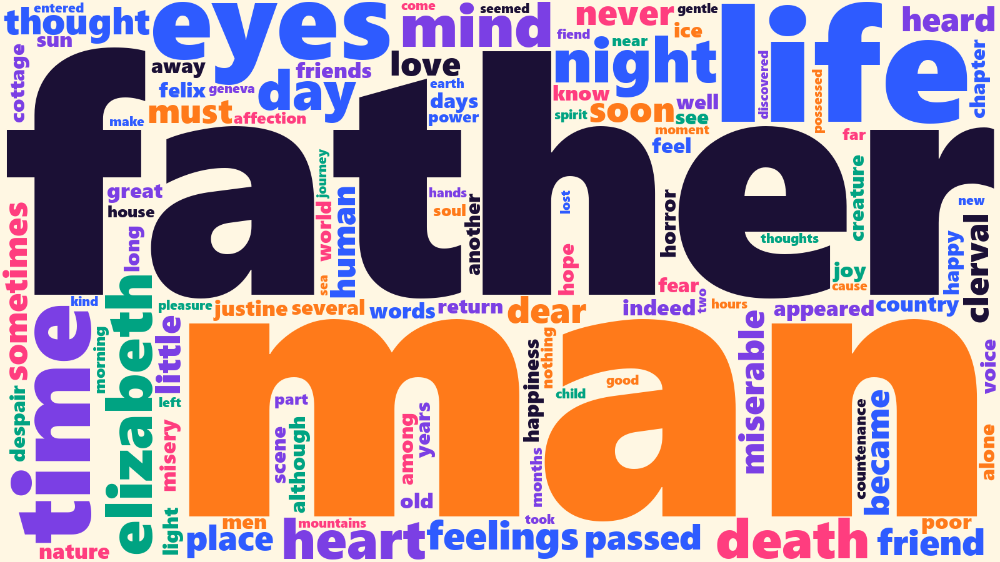

Words

## Think: Week 5 (February 8 - 14)

English classes usually teach **close reading**: slowing down to look carefully at a single passage. Digital humanities added another option, often called **distant reading**: using computers to count and compare patterns across more text than any one person could read. This module tries both, using a classic DH tool and an AI assistant side by side.

Ted Underwood's "Seven ways humanists are using computers to understand text" is a friendly tour of what text analysis can do, from visualizing a single text to building statistical models of genre, and it argues that computational analysis isn't one new technology but "a wide-open conversation" across several disciplines. Notice his warnings, too: word clouds are eye-catching but don't tell you much, and a common word can look like an insight when it isn't. Miriam Posner's "How did they make that?" walks through real digital humanities projects, from a searchable map of the *Green Book* to a topic model of historical texts, and breaks each one down into **what it is**, **what you'd need to know** to build something like it, and how to **get started**. (Her suggestion for beginners in text analysis? Voyant Tools, which we'll use this module.)

**To do this week:**

- Read [Underwood](https://tedunderwood.com/2015/06/04/seven-ways-humanists-are-using-computers-to-understand-text/) and [Posner](https://miriamposner.com/blog/how-did-they-make-that/).
- Watch the lecture video in Webcourses and look through the [Module Three slides](slides/modulethree.html).
- Browse [Project Gutenberg](https://www.gutenberg.org/) and pick two or three texts you'd like to compare (see Step 1 below).

## Do: Week 6 (February 15 - 21)

### Watch First

Miriam Posner, author of this module's "How did they make that?", gives a tour of the kinds of text analysis digital humanists use. It's about half an hour, so feel free to watch it in two sittings.

<iframe src="https://www.youtube.com/embed/X5eAULsBm0w" title="Text Analysis: A Walking Tour of What People are Using in Digital Humanities Right Now" style="position: absolute; top: 0; left: 0; width: 100%; height: 100%; border: 0;" allow="accelerometer; clipboard-write; encrypted-media; gyroscope; picture-in-picture" allowfullscreen></iframe>

[Text Analysis: A Walking Tour of What People are Using in Digital Humanities Right Now](https://www.youtube.com/watch?v=X5eAULsBm0w): Miriam Posner (2021), about 31 minutes.

**As you watch:** For each method, ask what question it can answer about a text, and whether a chatbot could show its work on that same question.

*Optional:* for a hands-on walkthrough of the tool you'll use, watch [Introduction to Voyant Tools: Basic Distant Reading of Literature](https://www.youtube.com/watch?v=rQbf6V77ScA) (Digital Humanities & Video Game Studies Lab at UMF, about 21 minutes).

### Exercise: Distant Reading with Voyant and AI

[Voyant Tools](https://voyant-tools.org/) is a free, browser-based text analysis environment that has been a DH classroom staple for over a decade. Unlike a chatbot, Voyant doesn't generate anything: it counts, and it shows you exactly what it counted. That makes it a useful check on what an AI assistant tells you about a text.

Here's what Voyant looks like with Mary Shelley's *Frankenstein* loaded:

Notice the words **gutenberg** and **project** in the word cloud on the left. Project Gutenberg adds license text to the beginning and end of every file, and Voyant counts it along with the novel. Here is a word cloud of the same novel with that license text removed and common words like "the" and "and" filtered out:

Cleaning the text changed what we see. As you work, keep track of what *you* removed or changed, and why.

#### Step 1: Pick Your Texts

Choose two or three related texts from [Project Gutenberg](https://www.gutenberg.org/), which offers free, public-domain books. Pick texts you want to compare: two novels by the same author, two poets from the same period, a novel and its sequel, or several works in the same genre (for example, three early detective stories or three ghost stories). On each book's page, find the **Plain Text UTF-8** version and copy its link (or download the .txt file). For example, *Frankenstein* is [here as plain text](https://www.gutenberg.org/cache/epub/84/pg84.txt).

#### Step 2: Explore in Voyant

Go to [voyant-tools.org](https://voyant-tools.org/), paste your plain text links into the box (one per line) or upload your .txt files, and click **Reveal**. Spend some time with the default tools (the [Voyant documentation](https://voyant-tools.org/docs/) explains each one):

- **Cirrus** (the word cloud): Which words dominate? Click the settings icon to add words like "gutenberg," "project," "said," or character names to the stopword list, and watch the cloud change. **Screenshot 1:** your Cirrus word cloud.
- **Trends**: Click a word to see where it rises and falls across your texts.
- **Contexts**: See every appearance of a word with the words around it (this is called "keyword in context"). **Screenshot 2:** Trends or Contexts for a word you found interesting.

#### Step 3: Ask an AI Assistant the Same Questions

Open ChatGPT, Claude, Gemini, or Copilot and ask it about the same texts. If your tool lets you upload files, upload the plain text files; if not (or if the files are too large for your free tier), ask about the texts by title. Try prompts like:

> What are the most common meaningful words in [title], and what do they tell us about its themes?

> Compare [title] and [title]. What words or themes appear much more often in one than the other?

> Find three passages where the word "[a word you explored in Voyant]" appears, and explain what it means in each.

Then check its answers against Voyant. Did the chatbot's "most common words" match the actual counts? Did the passages it quoted really exist? (Search for them in Voyant's Contexts tool to find out.) **Screenshot 3:** a moment in your AI conversation where it was right or wrong about your texts.

### Discussion

| Points | What to post |
|--------|--------------|
| 3 | **Three screenshots**, 1 point each: your Voyant Cirrus word cloud, Voyant Trends or Contexts, and your AI conversation |
| 4 | **Reflection of at least 250 words** that answers the questions below |
| 1 | **One citation:** quote or point to a specific idea from Underwood or Posner, naming the author |
| 2 | **Two replies** to classmates, 1 point each (at least 50 words each) |
| **10** | **Total** |

Questions to answer in your reflection:

- Which texts did you choose, and what is one pattern you found across them that you wouldn't have noticed from close reading alone?
- Where did the AI assistant agree with Voyant, and where did it get the numbers, quotes, or patterns wrong? Why might a text-generating tool be worse at counting than a tool built only to count?
- What did you remove or filter in Voyant, and how did that change what you saw?
- Describe your work the way Posner describes a project: what it is, what you needed to know to do it, and how someone else could get started.

**AI use:** use AI to analyze your texts, but write your reflection and your replies yourself, with no AI (see the [AI Use Policy](index.md#ai-use-policy)).

**Due Sunday, February 21 at 11:59 PM.** The discussion stays open until Monday, February 22 at 11:59 PM, then closes.
