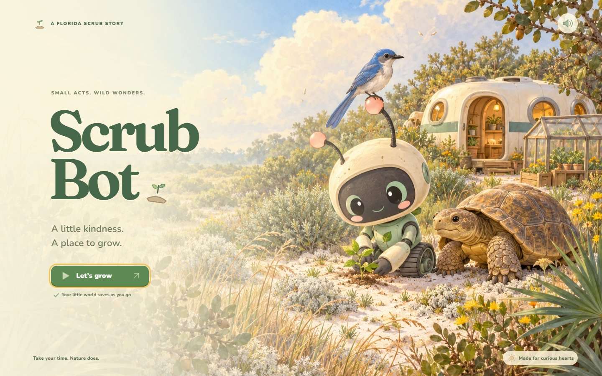

Puppet Masters

> “Who knew that copies could still be produced despite the absence of the original?” — the Laughing Man, [*Ghost in the Shell: Stand Alone Complex*](https://en.wikiquote.org/wiki/Ghost_in_the_Shell:_Stand_Alone_Complex)

Stand Alone Complex names something stranger than a conspiracy: coordinated-looking action with nobody actually coordinating it, and no originator you can point to and say "it started there." That's a useful, slightly unsettling frame for a coding agent that dispatches subagents, fresh copies of itself sent off to explore, test, or build part of a project and report back. Last week you made one thing in one pass. This week you'll keep going: plan a larger project, develop it through five iterations, and see what accumulates in the history when an agent and its copies do most of the building.

## Exercise: Iteration and Subagents

This week's reading is Simon Willison's ["Battle Drones—a vibe coded RTS with audio-based multiplayer"](https://simonwillison.net/2026/Oct/20/battledrones/), the story of a real-time strategy game built over "12 major iterations" and 321 commits by coding agents. Willison started by asking Claude for an MVP design ("Let's start with a MVP design, ask me some questions"), and it wasn't fun to play until a later version, after he prompted "This game isn't fun enough yet. Make it a LOT more fun." That run used dynamic workflows, which orchestrate "many subagents at once," and it went on overnight. You can [play the game](https://simonw.github.io/battledrones/), open the early versions he kept online, and read his [commit history](https://github.com/simonw/battledrones/commits/main/). Notice, too, what he admits along the way: "I was beginning to feel guilty at how little actual design input I had into the game."

Your task is to take on a **complex, interactive web project** of your own and develop it through **five distinct revisions** with Claude Code on the web or Codex. One tool is enough; using both is optional. A game is a great choice, but anything substantial and interactive works: an interactive story, a simulation, an educational tool, a visualization you can explore, or something tied to your own research. Choose something complex enough to be worth revising, and plan to work on it over several days.

In the video, I build [Scrub Bot](https://anastasiasalter.net/ScrubExplorationGame/), a cozy game about a small robot restoring an abandoned patch of Florida scrub. The idea comes from something I actually work on: finding ways to engage visitors to small nature preserves, especially kids. It took about six iterations and 18 commits over three days, though you only need five iterations. I start in Claude Code and then go back and forth with Codex to show how both tools work, and you can read the whole history in the [repository](https://github.com/AMSUCF/ScrubExplorationGame): Claude's commits list Claude as the author, while Codex's list me.

For an example of what this kind of project can become, look at my *Kairos* piece, [AI Admin: Provocations Through Generated Play](https://anastasiasalter.net/KairosAIAdmin/). It holds two iterations of the same p5.js game, a 2024 Writing Program Edition and a 2025 Digital Humanities Edition, built over about a hundred prompts with much earlier models (ChatGPT 4.0, Claude Opus 4.0 and Sonnet 4.0, and DALL-E 3). Play them in sequence and notice what changed between versions. Today's agents can go much further in five revisions.

### Setting Up Your Project

The setup is the same as last week, so look back at [Week Ten](weekten.md) for any step you need in detail.

1. **Create a new public GitHub repository** for this project, separate from last week's.
2. **Open Claude Code on the web** at [claude.ai/code](https://claude.ai/code) **or Codex** at [chatgpt.com/codex](https://chatgpt.com/codex), and select the new repository. If you gave the agent access to only last week's repository, add this one on GitHub under **Settings → Applications → Installed GitHub Apps → Configure**.
3. If you have images, sound, a dataset, or other files you want in the project, upload them now: **Add file → Upload files**.

### Revision 1: Plan, then build

Start in plan mode. In Claude Code, you can switch into plan mode as I do in the video, or start your prompt with: "Enter plan mode. Do not exit plan mode until I confirm the plan is ready. Ask clarifying questions until you understand the plan." (The same prompt works in Codex.) Then describe your idea. I adapted Willison's opening prompt for a mobile-friendly, *Animal Crossing*–inspired game set in the Florida scrub.

You don't need to choose your technology in advance or limit yourself to plain HTML, CSS, and JavaScript. The agent's questions will raise the options: Claude suggested Phaser, a game library, and I went with it. If you have a library in mind, such as p5.js, Phaser, Three.js, or D3.js, name it. Do say that your project should go on GitHub Pages, so that you can test each version and share it easily. If it needs to remember anything, as my game saves your progress, ask it to use the browser's local storage.

Answer the agent's questions, push back on the parts of the plan you don't like, and confirm it only when it describes what you want. Then let it build a first playable version, and turn on GitHub Pages as soon as you have one (see [Commits and Deploying](#commits-and-deploying) below). To keep it from stopping for approval, I accept the plan in Auto mode in Claude Code; in Codex, the similar access setting is "approve for me." Expect this first version to be rough. Mine used code-drawn placeholder art and wasn't much fun yet, and the challenge is to iterate it into something you'd want to use.

### Pacing Your Work

You don't have to babysit these runs. My first build took about an hour, and I came back to it the next day, which also let my usage limits reset. Later rounds ran from about 30 minutes to about two hours. Both tools work in the cloud, so you can step away and check in from your phone. If a run hits a usage limit, you can have it wait the limit out.

I used Opus 5.5 on Medium for most of the Claude Code work, and I'd stay at Medium or High. In Codex, I used GPT-6.1 Sol on Max for the first art pass, but High or Extra High should work well for most tasks. Keep an eye on the context meter in Claude Code, too: the longer the agent can go before it compacts, turning details into notes, the better it will perform.

### Revisions 2–5: Iterate

Each revision is a new round: play or test the current version, decide what it needs, prompt, review what the agent changed, and test it again on your live site. Some approaches to try, from the video and from Willison:

- **Specific feedback from testing:** "The second level is too easy and the controls don't work on my phone. Fix both." In the video, I play each version and dictate a list of edits with the microphone, and I highly recommend using voice for your revisions.
- **Errors:** you'll run into these more often on a project this size. Copy the exact error from the browser console into your next prompt, or send a screenshot of it.
- **An open-ended push:** "This isn't fun enough yet. Make it a LOT more fun." See what the agent decides "fun" means. I ask for "much more fun" in the video, along with specifics like storms and fires.
- **Critique before building:** "First research and then critique this design. Only build after we have agreed on any modifications."
- **New materials:** upload images or sounds to the repository and ask the agent to work them in.
- **Generated art (optional):** you can stick with code-drawn art. In the video, Claude Code writes an art asset brief, and Codex uses it to generate the images with GPT Images. Let a pass like this run while you do something else.
- **Switching tools (optional):** Claude Code and Codex can work in the same repository. Codex needs a new environment for the repository first, and whichever agent you return to should start by reviewing what changed.

Keep the revisions distinct: each should change something you could describe in a sentence, not just fix a typo. One prompt will often produce several commits, and that's fine. Jot a line or two after each round (what you asked for, what changed, what surprised you) so you have material for your reflection. If you'd like to keep earlier versions playable, as Willison did, ask the agent to save each one in its own folder (`v1/`, `v2/`, and so on).

You don't need to ask for subagents: as your project grows more complex, the agent will start sending them out on its own. Here's Claude reviewing my game in ultracode, Claude Code's most intensive setting, which you don't need for this exercise:

> I’m launching four independent reviewers alongside my own test run, each checking a different angle—how the 48 new art keys wire into code, how the art renders in-game, load/memory cost, and the non-art changes in your commit—with every finding getting an adversarial re-check.

### Commits and Deploying

Turn on GitHub Pages early, so that you can test every revision on the live site. Both agents usually commit to a separate branch, and to keep things simple, I keep working on the agent's branch rather than merging after each round. If you do merge a pull request, choose **Create a merge commit** rather than **Squash and merge**, so that each revision's commits stay visible in your repository's history. If your project ends up split across branches, ask the agent to merge them.

How you deploy depends on what the agent built. For plain HTML, CSS, and JavaScript, use **Deploy from a branch** under **Settings → Pages**, as in [Week Ten](weekten.md), and choose the branch the agent is working on. A project with a build step, like mine (Phaser, TypeScript, and Vite), needs one more step. I started with **Deploy from a branch** too, and in the video you'll see the site fail to load, with an error in the browser console. To fix that, set **Settings → Pages → Source** to **GitHub Actions** and ask the agent to set up or fix the workflow that builds and deploys the site.

**For full credit, your discussion post must include:**

-   your GitHub repository link and GitHub Pages link, demonstrating five successful iterations (3 points);
-   a reflection on your process (1 point; see the discussion questions below);
-   and replies to two peers (1 point / reply).

### Discussion

Share your repository and GitHub Pages links so we can all try each other's projects. Your reflection doesn't have to be as long this week, since most of your time will go into the revisions. Share your process and what you observed:

- Does this way of working give you more of a sense of intentionality?
- What perspective does it give you on the labor questions and the larger questions around AI?

Don't forget to reply twice to peers (1 point / reply) for full credit!
