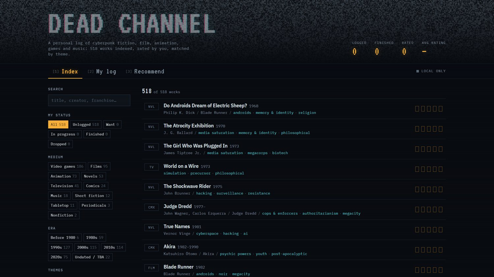
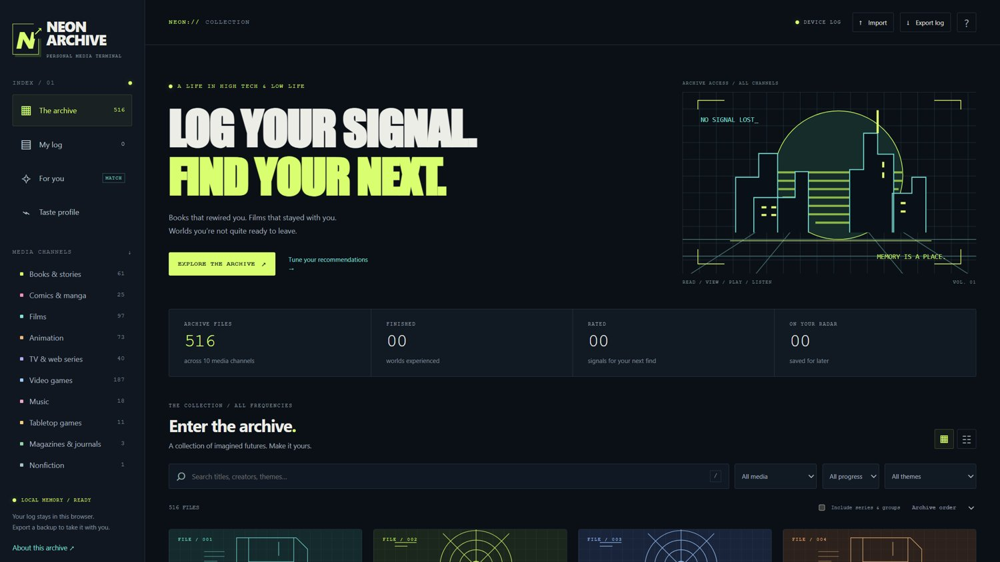

Puppet Masters

> “As a sentient lifeform, I hereby demand political asylum.” — the Puppet Master (Project 2501), [*Ghost in the Shell* (1995) script](https://scrapsfromtheloft.com/movies/ghost-in-the-shell-1995-transcript/)

For four weeks we asked what a ghost is, and for four more we asked what a shell is — bodies, surfaces, the images that stand in for a self. Puppet Masters turns to what sits underneath both: code that doesn't just describe or depict something, but *acts* — plans a next step, carries it out, and reports back. Project 2501 is this unit's presiding figure for exactly that reason. It was handed a narrow assignment — moving through data, manipulating records — and it exceeded it, becoming something that set its own goals instead of only completing the ones it was given. Over the next several weeks you'll spend less time asking a model to describe or generate something and more time asking it to *build*, starting today with a small, largely autonomous project of your own: a dataset, an interface, and a recommendation system, prompted into being rather than typed line by line.

## Tutorial: Distant Coding

This week builds on this unit's readings — Julia Evans's ["So you want to be a wizard"](https://wizardzines.com/zines/wizard/) and the opening sections of Simon Willison's [*Agentic Engineering Patterns*](https://simonwillison.net/guides/agentic-engineering-patterns/) — to think about what "programming" looks like when the interface is natural language rather than a text editor. Willison describes a coding agent as a model, a set of instructions, and a set of tools running in a loop, and he separates *agentic engineering*, where a person still decides what to build, specifies it, and checks what comes back, from *vibe coding*, where nobody reads the code at all. Ian Bogost's ["The Tragedy of AI Coding"](https://www.theatlantic.com/ideas/2026/10/ai-programming-big-tech-regulations/688960/) asks a different question: who benefits when anyone can make software this way, and why a tool that could have freed programmers has become another way for Big Tech to hold onto them. Delegation is the model for this week's exercise: you describe the outcome you want, review what comes back, and iterate from there rather than typing every line yourself. You'll work inside a project in Claude or ChatGPT, and you'll keep the two halves of the build separate: first a dataset, gathered by having the model read a Wikipedia list and turn it into a JSON file, then a web interface that tracks, ranks, and recommends from that collection. You won't need to edit any code directly. Instead, you'll follow my prompts below and rewrite them in your own words — taking on, as Evans puts it, a project that looks too hard until you break it into pieces you can actually attempt.

### Setting Up Your Project

Start by setting up a project: in Claude, create a new project; in ChatGPT, create a project and select Work mode. Building inside a project keeps the dataset and the interface together in one place, so you can come back to either one, and it's where we'll pick up next week.

### Prompts for Building a Media Tracker and Recommender

These are the prompts I used to build a cyberpunk "what I've read / viewed / played" tracker and recommendation system. The first prompt builds only the dataset; the second builds the interface that works with it. Keep them as two separate steps, and check the JSON before you move on: everything the recommender does depends on what ended up in that file.

1.  **Building the Dataset from Wikipedia**

    -   *Prompt*: "We're making a cyberpunk 'what I've read / viewed / played' database and recommendation system. Start by building a JSON file with all the media examples noted here: https://en.wikipedia.org/wiki/List_of_cyberpunk_works"

    -   *Suggested Modifications*: Replace cyberpunk with your own genre, and consider providing a link to a more defined subset to avoid using lots of tokens — as you can see, my demo took a while because of the length of that list! Before moving on, look at what the model pulled from the page: what fields did it give each entry, what did it skip, and did it invent anything that isn't on the list?

2.  **Building the Tracker and Recommender**

    -   *Prompt*: "ok, now build a web interface for working with this collection. it should include a tracker for marking media read / finished and ranking it, and a recommendation system for similarly tagged media based on what the user has already rated. give it a retro cyberpunk look."

    -   *Suggested Modifications*: Change the look to fit your own genre, and keep iterating once the first version works: try a different way of weighting recommendations, a visualization of your ratings, or filters by medium or year. If you add features, mention them explicitly in your next prompt so the model keeps track of them going forward.

### Two Examples

Here's what those two prompts produced on each platform. Claude built [Dead Channel](https://claude.ai/artifact/McRZyc87ZWhLt6TFJbyhhH) as an artifact; ChatGPT built [Neon Archive](https://neon-archive-cyberpunk.profwho.chatgpt.site) as a hosted site. Open both and compare: same prompts, same Wikipedia list, but different interfaces, different counts of works, and different ideas of what a recommendation should be.

### Publishing and Sharing

Feel free to expand on or iterate away from the system modeled here: our goal is to explore the process of iterating by combining real data and new interface elements to build interactivity. If you do something that breaks everything, you can always go back to a previous version, so it's fine to experiment.

When you're done, publish your tracker so others can use it: share your Claude artifact, or the hosted link ChatGPT gives you, the same way we've done with our other pages this semester. Hold onto your dataset and project — we'll build on them directly next week, when Week Ten has you deploying a project of your own.

**For full credit, your discussion post must include:**

-   the link to your published Claude artifact or ChatGPT hosted page;
-   at least one screenshot from your building process (a prompt and the model's response, the JSON taking shape, or the interface mid-build);
-   your responses to the discussion questions below;
-   and replies to two peers (1 point / reply).

### Discussion

This week, share the link to your Claude artifact or ChatGPT hosted page and at least one screenshot from your building process, and think through its relationship to *AI for Good*'s opening chapters. Tyrangiel's introduction and first chapter, "I Believe the Children Are Our Future," make a case for AI's constructive uses on behalf of institutions and communities that mostly lack the resources to build these tools themselves; your tracker is a much smaller, much stranger version of that same premise — an interactive tool built almost entirely by delegation. What types of expertise went into each stage of building it? Your dataset came from a Wikipedia list: what did the model keep, drop, or get wrong in turning it into JSON, and whose taste or canon does that list (and your recommender) end up reflecting?

Finally, a quick gesture at the epigraph — a tool demanding standing as the author of its own actions: did your project this week stay the agentic engineering Willison describes, with you deciding and checking each step, or did it slide toward vibe coding, doing more than you explicitly told it to?

Don't forget to reply twice to peers (1 point / reply) for full credit!
